# VARUN-FUSION Architecture

## 1. System Overview
**VARUN-FUSION** is an adaptive, AI-augmented multi-model forecast post-processing and blending engine engineered for operational meteorologists at the India Meteorological Department (IMD) and State Disaster Management Authorities (SDMA).

Submitted for **Smart India Hackathon 2026**, Problem Statement **26081** (*Hybrid AI–NWP Multi-Model Forecast Blending System*), Ministry of Earth Sciences (MoES), Theme: Disaster Management. Developed by **Team CodeX_2026** (Team ID: **159951**).

```mermaid
flowchart TD
    subgraph S1["1. Data Ingestion & Adapters"]
        IFS["ECMWF IFS (0.25° NWP)"]
        AIFS["ECMWF AIFS (0.25° AI)"]
        GFS["NOAA GFS (0.25° NWP)"]
        NCMRWF["NCMRWF NEPS-G / NCUM (0.25°)"]
        TRUTH["Truth: ERA5 + IMD Gridded Rainfall"]
    end

    subgraph S2["2. Harmonization & Regridding"]
        REG["Common Grid (0.25° Lat 17-24°N, Lon 81-90°E)"]
        ACC["IMD 03:00 UTC 24h Accumulation & Unit Harmonization"]
        STORE["Canonical Zarr / Parquet Storage (data/harmonized/)"]
    end

    subgraph S3["3. Rolling Verification & Skill Engine"]
        CONT["Continuous: RMSE, MAE, Bias"]
        PROB["Probabilistic: CRPS, Brier Score, Reliability"]
        EVT["Events: FSS (1, 3, 5, 9 cells), CSI, POD, FAR, SEEPS"]
        S_HIST["Skill History Store (PostgreSQL / SQLite + Parquet)"]
    end

    subgraph S4["4. Blending & Safe Fallback Engine"]
        B0["B0: Best Single Model"]
        B1["B1: Equal-Weight Multi-Model Mean"]
        B2["B2: Inverse-Error (w ∝ 1/(RMSE+ε)^p)"]
        B3["B3: Adaptive ML Gate (LightGBM + Softmax)"]
        EXT["Extreme-Aware Layer & Minority Extreme Alerts"]
        CONF["Confidence Index (Spread, Entropy, Skill, Completeness)"]
        FALL["Safe Fallback Cascades (B3 → B2 → B0)"]
    end

    subgraph S5["5. Forecaster Serving Layer"]
        API["FastAPI Operational REST API (/api/v1)"]
        DASH["Next.js 14 Forecaster Operations Center (MapLibre + Deck.gl)"]
        PDF["Automated Shift Handover Report Generator"]
    end

    S1 --> S2
    S2 --> S3
    S3 --> S4
    S2 --> S4
    S4 --> S5
```

## 2. Core Mathematical Formulation
Given spatial coordinates $x = (\text{lat}, \text{lon})$, forecast lead time $\tau \in \{24, 48, 72, 96, 120\}\text{ h}$, and regional/meteorological context $\mathbf{C}(x, \tau)$, the blended deterministic forecast $F_{\text{blend}}(x, \tau)$ is given by:

$$F_{\text{blend}}(x, \tau) = \sum_{m=1}^{M} w_m(x, \tau, \mathbf{C}) \cdot F_m(x, \tau)$$

Subject to physical non-negativity and convex combination constraints:
$$w_m(x, \tau, \mathbf{C}) \ge 0, \quad \sum_{m=1}^{M} w_m(x, \tau, \mathbf{C}) = 1$$

## 3. Operational Integrity & Provenance Tracking
Every dataset, raster tile, and point time-series emitted by VARUN-FUSION bears:
1. **Provenance Tag**:
   - `LIVE`: Ingested directly from real-time operational model streams.
   - `CACHED`: Sourced from authenticated local verified historical caches.
   - `SYNTHETIC`: Generated against documented schema when proprietary operational feeds are offline.
2. **Forecaster Guidance Disclaimer**:
   `"Forecaster guidance — not a public warning"`.
