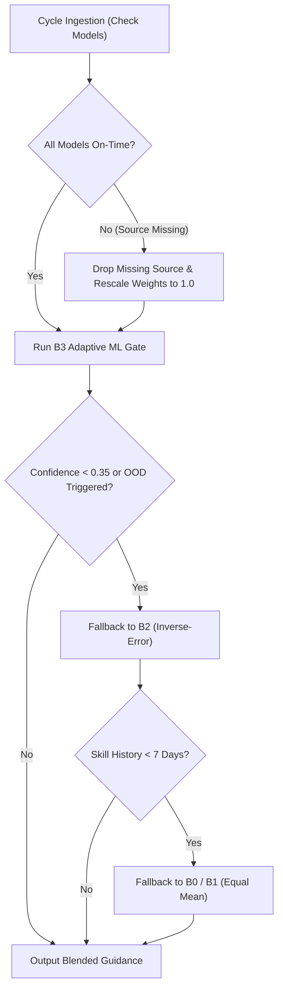

# VARUN-FUSION Scientific & Operational Methodology

> **Smart India Hackathon 2026** | **Problem Statement 26081**  
> **Ministry of Earth Sciences (MoES)** | **Theme: Disaster Management**  
> **Team CodeX_2026 (Team ID 159951)**

---

## 1. Executive Summary & Purpose
VARUN-FUSION is an adaptive multi-model forecast post-processing and blending engine designed to empower operational meteorologists at the India Meteorological Department (IMD) and State Disaster Management Authorities (SDMA). By fusing physics-based Numerical Weather Prediction (NWP) models (ECMWF IFS, NOAA GFS, NCMRWF NCUM/NEPS) with cutting-edge artificial intelligence forecasts (ECMWF AIFS), VARUN-FUSION dynamically produces optimized, context-aware meteorological guidance.

---

## 2. Core Blending Equation
For spatial location $x = (\text{lat}, \text{lon})$, forecast lead time $\tau \in \{24, 48, 72, 96, 120\}\text{ h}$, and variable $v$, the blended forecast $F_{\text{blend}}(x, \tau)$ is formulated as a convex combination of $M$ available models:

$$F_{\text{blend}}(x, \tau) = \sum_{m=1}^{M} w_m(x, \tau, \mathbf{C}) \cdot F_m(x, \tau)$$

### Physical Constraints
To prevent unphysical artifacts and ensure operational stability:
1. **Non-negativity**: $w_m(x, \tau, \mathbf{C}) \ge 0 \quad \forall m$
2. **Convex Simplex Sum**: $\sum_{m=1}^{M} w_m(x, \tau, \mathbf{C}) = 1.0$
3. **Diversity Floor & Anti-Monopoly Cap**:
   $$0.05 \le w_m(x, \tau, \mathbf{C}) \le 0.80$$
   *(guarantees that no single model unilaterally dominates when multi-model diversity is required for disaster safety, while preventing severe over-penalization).*

---

## 3. Blending Methods Hierarchy

### B0: Best Single Model
Dynamically identifies the single model with the minimum domain-wide rolling verification RMSE over the recent 7–30 day window:
$$m^* = \arg\min_m \text{RMSE}_m(\tau), \quad w_{m^*} = 1.0, \quad w_{m \ne m^*} = 0.0$$

### B1: Equal-Weight Ensemble Mean
Unweighted multi-model consensus:
$$w_m = \frac{1}{M}$$

### B2: Spatial Inverse-Error Weighting
At each individual $0.25^\circ \times 0.25^\circ$ grid cell $x$, weights are computed from verified rolling Root Mean Square Error fields:
$$\tilde{w}_m(x, \tau) = \frac{1}{\left(\text{RMSE}_m(x, \tau) + \epsilon\right)^p}$$
where $p=2.0$ and $\epsilon=0.01\text{ mm}$. Weights are subsequently normalized and projected onto the constrained simplex.

### B3: Adaptive ML Gate (LightGBM)
The core intelligence engine trains a gradient-boosted decision tree regressor (LightGBM) to predict the expected absolute error $\hat{e}_m(x, \tau)$ of each model conditioned on a multi-dimensional context vector $\mathbf{C}(x, \tau)$:
$$\hat{e}_m(x, \tau) = f_{\text{LGBM}}\left(\mathbf{C}(x, \tau), \text{source\_id}=m\right)$$

#### Context Feature Vector $\mathbf{C}(x, \tau)$:
1. **Geographic Coordinates**: $\text{lat}, \text{lon}$
2. **Terrain & Elevation**: Orographic height (Eastern Ghats, Similipal highlands, coastal slope)
3. **Sub-Region ID**: Coastal belt, Inland plains, Highlands
4. **Temporal Cyclical Encoding**: $\sin\left(\frac{2\pi \cdot \text{DOY}}{365.25}\right), \cos\left(\frac{2\pi \cdot \text{DOY}}{365.25}\right)$
5. **Lead Time**: $\tau$ (24h to 120h)
6. **Synoptic Weather Regime**: Clustered $k$-means regime identifier ($k=4$: Active Depression, Normal Flow, Break Monsoon/Heat, Post-Depression)
7. **Inter-Model Spread**: $\sigma_{\text{models}}(x) = \text{std}_m\left(F_m(x)\right)$
8. **Recent Verification Trajectory**: 7-day rolling RMSE and bias

#### Temperature-Scaled Softmax Conversion:
Predicted errors are converted to weights using an exponential temperature scaling:
$$\tilde{w}_m(x) = \frac{\exp\left(-\hat{e}_m(x) / \tau\right)}{\sum_{k=1}^{M} \exp\left(-\hat{e}_k(x) / \tau\right)}$$
where $\tau = 1.0$ controls the sharpness of model discrimination. Weights are then clipped to $[0.05, 0.80]$ and renormalized.

---

## 4. Extreme-Aware Blending & Minority Extreme Signals

### The Disaster Problem: "Ensemble Smoothing of Convective Cores"
Standard multi-model averaging often washes out localized heavy rainfall peaks (e.g. 150 mm depression cores get averaged down to 50 mm, failing to trigger emergency flood response).

### The VARUN-FUSION Solution:
1. **Event-Specific Weighting**: Uses Critical Success Index (CSI) and Fractions Skill Score (FSS) at scale 3 ($3 \times 3$ grid neighborhood) to compute separate event risk weights.
2. **Extreme Risk Layer**: Computes probability-like score:
   $$\text{Risk}(x) = \sum_{m=1}^{M} w_m^{\text{event}}(x) \cdot \mathbb{I}\left(F_m(x) \ge \text{Threshold}\right)$$
   Categorized into **NONE** ($<0.20$), **WATCH** ($0.20-0.45$), **ALERT** ($0.45-0.70$), and **WARNING** ($\ge 0.70$).
3. **Minority Extreme Signal Detection**:
   $$\text{Signal}(x) = \left[\bigvee_{m} \left(F_m(x) \ge \text{Threshold}\right)\right] \bigwedge \left[F_{\text{blend}}(x) < \text{Threshold}\right]$$
   If *any* verified operational model predicts an extreme event above threshold (e.g. IMD Heavy Rain $\ge 64.5$ mm) but the blended average stays below the threshold, VARUN-FUSION **flags it explicitly** as an operational alert marker with the model name, coordinates, and predicted value. **Never suppressed, always surfaced.**

---

## 5. Forecaster Confidence Formulation
Confidence $C(x) \in [0.0, 1.0]$ combines four independent epistemic and aleatoric uncertainty components:
$$C(x) = 0.35 \cdot S_{\text{spread}}(x) + 0.25 \cdot S_{\text{entropy}}(x) + 0.25 \cdot S_{\text{skill}}(x) + 0.15 \cdot S_{\text{comp}}$$

1. **Normalized Spread Score**: $S_{\text{spread}}(x) = \exp\left(-\frac{\sigma_{\text{models}}(x)}{\sigma_{\text{clim}}}\right)$ (models agree $\to$ higher confidence).
2. **Weight Entropy Score**: $S_{\text{entropy}}(x) = 1.0 - 0.4 \cdot \frac{-\sum w_m \ln(w_m)}{\ln M}$ (decisive model preference $\to$ higher confidence).
3. **Recent Verification Skill**: $S_{\text{skill}}(x) = \exp\left(-\frac{\text{RMSE}_{\text{blend}}(x)}{\text{RMSE}_{\text{norm}}}\right)$ (historically accurate $\to$ higher confidence).
4. **Data Completeness**: $S_{\text{comp}} = \frac{M_{\text{present}}}{M_{\text{configured}}}$ ($4/4$ models present $= 1.0$).

### Operational Labels:
- **HIGH**: $C(x) \ge 0.70$ (Solid green operations state)
- **MEDIUM**: $0.40 \le C(x) < 0.70$ (Hatched amber advisory state)
- **LOW**: $C(x) < 0.40$ (Cross-hatched red alert state; triggers safe fallback)

---

## 6. Safe Fallback Cascade Hierarchy

Every automated fallback event is permanently logged with its diagnostic rationale in the database and surfaced as an audit pill on the forecaster UI.
